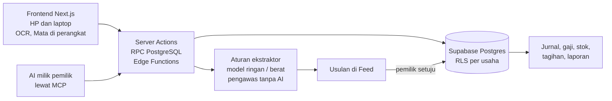

# Nadi

**Sistem saraf untuk usaha: platform operasional berbasis AI untuk UMKM Indonesia.**
Lempar berkas apa saja (foto nota, PDF tagihan, Excel karyawan, CSV mutasi bank, foto struk). Nadi membaca dan merapikannya, lalu menyiapkan usulan. Data baru berubah setelah pemilik menyetujui.

- Aplikasi: https://nadiusaha.my.id (alamat lama https://nadi-swart.vercel.app tetap jalan; halaman publiknya dialihkan ke domain ini)
- Demo tanpa daftar (usaha contoh baca-saja, data karangan): https://nadiusaha.my.id/demo dan https://nadiusaha.my.id/demo/toko
- Video demo 4:38: [`docs/promo/nadi-demo.mp4`](docs/promo/nadi-demo.mp4)

## Masalah dan pengguna

Usaha kecil berjalan di atas kertas dan chat: nota difoto, gaji dihitung di Excel, absen ditulis di buku, tagihan dikirim lewat WhatsApp. Pemilik mengetik ulang semuanya, atau tidak mencatat sama sekali.

Aplikasi yang otomatis dijual per bagian, dengan harga resmi per 3 November 2026 ([`docs/bisnis/harga-pesaing.md`](docs/bisnis/harga-pesaing.md)):

| Bagian | Harga |
|---|---|
| Kasir dan operasional | Rp249.000-Rp999.000 per outlet per bulan |
| Modul AI | +Rp499.000 per outlet per bulan |
| Gaji/HR | Rp12.500-Rp20.000 per karyawan per bulan |

Pengguna:
- **Pemilik UMKM:** toko, warung makan, bengkel, laundry, salon, klinik, kontraktor kecil, produksi rumahan. Memutuskan dari HP.
- **Admin atau akuntan:** bekerja di laptop.
- **Staf:** absen, izin, klaim, dan tugas dari HP.

## Fitur utama (berjalan di produksi, dengan bukti tes)

| Fitur | Bukti |
|---|---|
| Lempar berkas (10 jenis) menjadi usulan di Feed; tiap usulan menulis "Kalau disetujui: …" dan rincian sebelum/sesudah | `docs/quality/eval-lempar.md` (10/10), `e2e/lempar.spec.ts`, `e2e/rincian.spec.ts` |
| Kerja dari AI milik pemilik lewat MCP (`tulis_draf`, `baca_draf`, `ubah_draf`) dan layar tinjau draf | `supabase/tests/ai_draft.test.sql`, `src/lib/mcp/protokol.test.ts`, `e2e/siapkan.spec.ts` |
| Belajar format: format baru dibaca AI sekali, lalu dibaca aturan tanpa token; aturan diperiksa pengawas deterministik dan masa bayangan 2× | `docs/quality/eval-ekstraktor.md` (396/399 bidang, token 0), `src/lib/pengawas.test.ts`, `e2e/struk-belajar.spec.ts` |
| Tagihan bernomor + QRIS + halaman bayar publik, cocok mutasi bank, jurnal otomatis, laporan keuangan, aset tetap, anggaran, konsolidasi, kasir luring | `supabase/tests/*.test.sql`, `e2e/kasir.spec.ts`, `e2e/pembiayaan.spec.ts` |
| Gaji dengan PPh 21 dan BPJS, Gerbang Gaji yang menahan nama mencurigakan, lembur PP 35/2021, absen dengan cek wajah, izin, rekrutmen, kinerja, kursus | `e2e/gaji.spec.ts`, `supabase/tests/kinerja.test.sql` |
| Mata: hitung kunjungan dari kamera di perangkat (tanpa wajah), peta panas, papan informasi kamera UU 27/2022 | `src/lib/mata/jejak-nyata.test.ts` (footage CCTV asli), `e2e/mata-jejak.spec.ts` |
| Alur otomatis, tanya data dalam bahasa sehari-hari, Sarapan Data, kalender kepatuhan | `e2e/otomasi.spec.ts`, `e2e/tanya.spec.ts`, `docs/quality/eval-tanya.md` |
| Satu kerangka untuk HP, tablet, dan laptop; cari fitur Ctrl K | `e2e/kerangka.spec.ts`, `e2e/cari.spec.ts` |

Jumlah per 6 November 2026:

| Komponen | Jumlah |
|---|---|
| Migrasi SQL | 169 |
| Tes SQL (termasuk isolasi antar-usaha) | 133 |
| Berkas tes unit | 124 |
| Spesifikasi e2e Playwright | 109 |
| Halaman aplikasi | 59 |

## Teknologi

| Lapisan | Pilihan (versi dari `apps/web/package.json`) |
|---|---|
| Frontend | Next.js 16.4.5 (App Router), React 19.3.1, Tailwind CSS 4, TypeScript, PWA |
| Backend | Server Actions, RPC PostgreSQL, Supabase Edge Functions (Deno), server MCP Nadi |
| Basis data | Supabase PostgreSQL: Row Level Security per usaha, pg_cron, pg_net, pg_partman, Realtime |
| Hosting | Vercel (sin1), Supabase (ap-southeast-1) |
| Di perangkat | tesseract.js 7.0.0 (OCR), transformers.js 4.3.1 (deteksi orang, transkrip), MediaPipe (cek wajah) |

## Implementasi AI

Prinsipnya **tangga kecerdasan**:

1. Aturan pasti lebih dulu.
2. Model kelas ringan bila aturan tidak cukup.
3. Model kelas berat hanya bila keyakinan model ringan di bawah ambang.

Model bahasa dipanggil lewat API Anthropic dari Edge Functions. ID model disimpan di tabel `konfigurasi` (kunci `model_ai`), tidak ditulis di kode.

| Bagian | Metode | Fungsi |
|---|---|---|
| Baca berkas | aturan ekstraktor, lalu model ringan, lalu model berat | teks dan tata letak menjadi jenis, bidang, dan usulan |
| Belajar format | model berat menulis aturan baca; pengawas tanpa AI memeriksa; bayangan 2× sebelum aktif | format yang sama berikutnya dibaca tanpa token |
| Foto struk | OCR di HP, model ringan bila OCR ragu | pemasok, tanggal, total |
| Tanya data | pengurai aturan ke 13 niat tetap; model hanya memetakan kalimat baru | angka dari rumus sumber yang sama dengan laporan |
| Pindah data | model hanya melihat judul dan tipe kolom, bukan isi | peta kolom dari aplikasi lama |
| Mata | beda latar + pelacak di perangkat; RF-DETR nano untuk kamera miring | rekap kunjungan per jam, tanpa data per orang |
| AI milik pemilik | ChatGPT, Claude, Gemini, atau AI lain lewat MCP | menulis draf yang ditinjau pemilik |

Keluaran model diperlakukan sebagai masukan tidak tepercaya ([`docs/quality/injeksi-prompt.md`](docs/quality/injeksi-prompt.md)). Model tidak pernah menyetujui uang, menghapus, atau menyembunyikan apa pun dari pemilik. Token per usaha tercatat di tabel `pemakaian_ai`.

## Arsitektur



## Menjalankan secara lokal

Butuh Node 22.12+, pnpm 10 (packageManager pnpm@10.29.2), dan proyek Supabase.

```bash
pnpm install
# apps/web/.env.local (tanpa rahasia di repo):
#   NEXT_PUBLIC_SUPABASE_URL=https://<proyek>.supabase.co
#   NEXT_PUBLIC_SUPABASE_PUBLISHABLE_KEY=<kunci publik>
# Migrasi: terapkan berkas supabase/migrations/*.sql berurutan; tes SQL di supabase/tests.
# Edge Functions membutuhkan secret ANTHROPIC_API_KEY di Supabase (tidak pernah di repo).
pnpm dev          # http://localhost:3000
pnpm test         # tes unit (Vitest)
pnpm e2e          # tes e2e (Playwright), butuh apps/web/.env.e2e.local berisi akun uji
bash loop/gate.sh # gerbang lengkap: rahasia, jejak, lint, tipe, unit, build
```

## Struktur repo

- `apps/web`: aplikasi Next.js.
- `supabase/migrations`: salinan persis setiap migrasi.
- `supabase/tests`: tes SQL.
- `supabase/functions`: Edge Functions.
- `docs`: rencana, desain, riset, kualitas, aset.
- `loop`: catatan kerja dan gerbang otomatis. Mulai dari [`loop/README.md`](loop/README.md).

## Keamanan dan privasi

- **Isolasi:** setiap tabel usaha memakai `perusahaan_id` dan Row Level Security dari klaim JWT. Tidak ada service-role key di aplikasi.
- **Data uji:** hanya data sintetis.
- **Mata:** tidak menyimpan wajah atau gambar. Yang dikirim hanya jumlah dan menit per jam.
- **Celah keamanan:** laporkan secara pribadi ke pemilik repo lewat GitHub, jangan lewat issue publik.

## Tim

- **I Made Tristan Hope Firdaus:** semua peran (produk, desain, pengembangan, pengujian).

## Keterbatasan dan rencana

- **Pengguna:** belum ada pengguna nyata. Angka penggunaan berasal dari usaha uji dengan data sintetis.
- **Mata:** pada footage CCTV asli, dua orang yang berjalan berdempetan kadang terbaca dua. Setelan bawaan butuh "Kepekaan tinggi" untuk cahaya redup.
- **Tanya data:** hanya menjawab 13 jenis pertanyaan tetap.
- **Tanda tangan elektronik:** belum tersertifikasi (butuh PSrE).
- **Konektor Shopee/TikTok Shop:** menunggu akun mitra.
- **Hosting:** masih paket gratis yang belum untuk penggunaan komersial.
- **Rencana:** halaman publik dan panduan, denah kamera Mata dari satu bingkai, jembatan CCTV lewat go2rtc, mitra akuntan.

## Sumber pihak ketiga

Daftar lengkap dengan lisensi: [`docs/ASSETS.md`](docs/ASSETS.md).

- **Pustaka:** semua di `package.json`.
- **Huruf:** Plus Jakarta Sans, Bricolage Grotesque, Big Shoulders, dan IBM Plex Mono (SIL OFL 1.1).
- **Ikon:** Phosphor Icons (MIT).
- **Model:** transformers.js, Whisper small ONNX, RF-DETR nano ONNX, dan MediaPipe (Apache-2.0).
- **Dataset:** IPIP Big-Five (domain publik).
- **Video demo:**
  - footage kamera Pexels oleh Shruthi Pradeep (Pexels License);
  - efek suara freesound (CC0);
  - musik "Inspiring Advertising" oleh Rafael Krux, filmmusic.io (CC BY 4.0);
  - GSAP (lisensi tanpa biaya).

## Lisensi

Belum ditentukan. Hak cipta pada pemilik repo.
